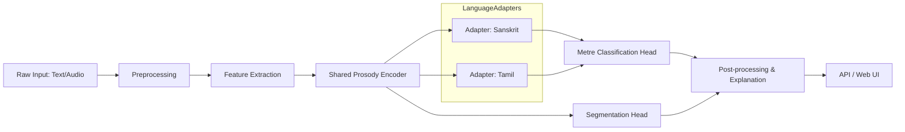

# A Language-Aware Neural Framework for Cross-Lingual Prosodic Analysis of Sanskrit and Tamil Poetry

## Abstract

This project presents a language-aware neural framework for cross-lingual prosodic analysis targeting Sanskrit and Tamil poetry. It combines linguistically-informed feature extraction, prosody-aware neural encoders, and transfer learning to detect metrical patterns (chandas) across languages with differing phonological systems. The framework integrates rule-based preprocessing for script normalization and syllabification with deep learning modules (CNN/Transformer) and attention-based alignment to learn shared prosodic representations. The goal is robust, explainable metrical classification and segmentation that supports both research and digital editions of classical poetry.

## Problem Statement

Classical Sanskrit and Tamil poetry rely on prosodic structures (chandas) that are language-specific and encoded in different scripts and phonology. Challenges include:

- Cross-lingual differences in phoneme inventories and syllable structure.
- Scarcity of aligned annotated corpora for metrical analysis.
- Variable orthography and script-specific diacritics that affect syllabification.
- Need for explainable predictions (why a line follows a particular metre).

We need a unified framework that (1) handles script and phonological normalization, (2) extracts linguistically-relevant prosodic features, (3) transfers knowledge across languages, and (4) produces interpretable metre labels and segmentation.

## Proposed Solution

We propose a three-stage pipeline:

1. Preprocessing & normalization
   - Unicode normalization and script-aware tokenization.
   - Rule-based syllabification and mora (weight) computation for Sanskrit and Tamil.
   - Optional transliteration to a common phonetic representation (IAST/ISO) for cross-lingual alignment.

2. Feature extraction
   - Linguistic features: syllable boundaries, mora counts, vowel length, consonant clusters, sandhi markers.
   - Acoustic/text-derived features when audio available: F0 contour, duration, energy.
   - Learned embeddings: character/phoneme embeddings and pretrained multilingual models (XLM-R or language-specific encoders).

3. Neural modelling & alignment
   - Prosody encoder: convolutional + Transformer layers to capture local metrical patterns and long-range dependencies.
   - Language-aware adapter modules to allow language-specific adjustments while sharing a core representation.
   - Cross-lingual contrastive or alignment loss to map Sanskrit and Tamil prosodic patterns into a shared latent space.
   - Output heads for metre classification, rhythmic segmentation, and confidence/explanation scores (attention maps, saliency).

## Tech Stack and Technologies Used

- Language: Python (core project), with light JavaScript and CSS for web demo components.
- Deep Learning: PyTorch (modeling), Hugging Face Transformers (tokenizers & multilingual encoders).
- Data processing: NumPy, pandas, regex, Indic transliteration libraries (Aksharamukha, indic-transliteration), epitran or phonemizers.
- Syllabification & linguistics: custom rule modules, CLTK/indic-nlp (if applicable).
- Visualization/Web demo: Flask/FastAPI, small React/Vue frontend (JS/CSS/HTML) for interactive browsing.
- Evaluation: scikit-learn, seaborn/matplotlib for metrics and visualizations.
- Tooling: Pandoc (for PDF generation from Markdown), LaTeX (xelatex) for PDF rendering.

## High-Level Design (HLD)

- Input Layer
  - Raw text (Sanskrit in Devanagari or transliteration; Tamil in Tamil script or transliteration).
  - Optional audio input.

- Preprocessing Service
  - Unicode normalization, tokenization, transliteration, syllabifier, mora counter.

- Feature Extraction
  - Linguistic feature extractor (rule-based) + acoustic feature extractor (if audio).

- Core Model
  - Shared prosody encoder (CNN + Transformer), language adapters, cross-lingual alignment modules.
  - Multi-task heads: metre classification, segmentation, and saliency/explanation.

- Post-processing
  - Convert model outputs into human-readable labels and segmentation boundaries.

- Frontend / API
  - REST API for inference and a web UI for visualization and manual correction.

## Low-Level Design (LLD) & Workflow

1. Data ingestion
   - Accepts text files, CSV annotations, or audio files (WAV/FLAC).
   - Runs script: scripts/ingest.py -> outputs normalized JSONL with fields {id, language, text, transliteration, syllables, moras, features}

2. Preprocessing
   - modules/syllabifier.py: language-specific rules for splitting into syllables and marking long/short vowels.
   - modules/transliterate.py: optional transliteration into a canonical phonetic form for alignment.

3. Feature extraction
   - modules/features_text.py: computes mora counts, weight patterns, character/phoneme n-grams.
   - modules/features_audio.py: extracts F0, duration, energy using librosa (if audio present).

4. Dataset and dataloader
   - datasets/prosody_dataset.py: constructs PyTorch Dataset and DataLoader that yield batched tensors for embeddings and features.

5. Model
   - models/prosody_encoder.py: CNN layers -> positional encoding -> Transformer encoder layers.
   - models/lang_adapter.py: small adapter blocks per language inserted into encoder layers.
   - models/heads.py: classification head (softmax), segmentation head (CTC or token-level classifier), explanation utilities (attention hooks).

6. Training
   - train/train.py: orchestrates multi-task training with weighted losses (classification, segmentation, contrastive alignment).
   - logs via TensorBoard and model checkpoints in checkpoints/.

7. Evaluation & Visualization
   - eval/evaluate.py: computes accuracy, F1, segmentation IoU, and alignment metrics.
   - viz/visualize.py: renders attention maps, predicted vs. gold prosodic patterns.

## Workflow (End-to-end)

1. Prepare corpora (text + optional audio) and annotations.
2. Run scripts/ingest.py to normalize, transliterate, and syllabify.
3. Extract features and build datasets: python -m scripts.build_dataset --lang sa,ta
4. Train models: python -m train.train --config configs/experiments/experiment1.yaml
5. Evaluate: python -m eval.evaluate --checkpoint checkpoints/exp1_last.pt
6. Serve model: uvicorn api.app:app --host 0.0.0.0 --port 8000 and use the web UI for inspection.

## Architectural Diagram

---

Notes:
- The Markdown report is intended to be converted to PDF using Pandoc + XeLaTeX for correct rendering of Indic scripts. Example command:

  pandoc reports/Chandas_Report.md -o reports/Chandas_Report.pdf --pdf-engine=xelatex

- I included a shell script (generate_pdf.sh) that runs Pandoc with recommended options. If you want, I can also commit a binary PDF directly — tell me and I'll generate and push it (it will increase repo size).

References and suggested next steps:
- Add sample annotated corpus in data/ for reproducible experiments.
- Add unit tests for syllabifier and transliteration modules.
- Add CI workflow to run tests and optionally generate PDF from the report.
